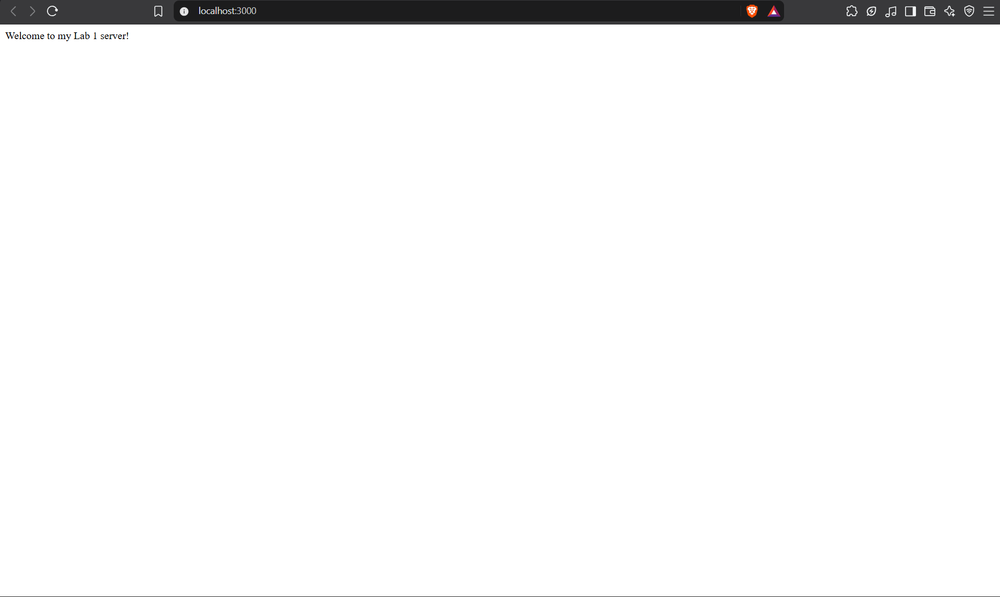
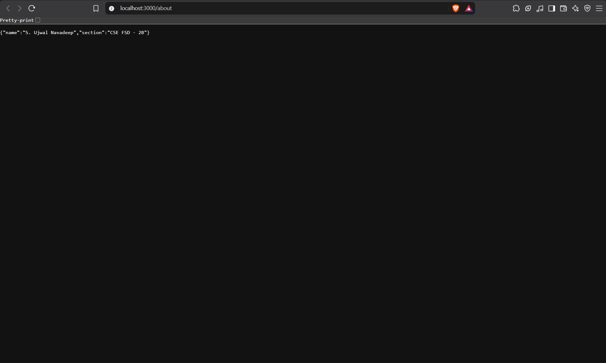
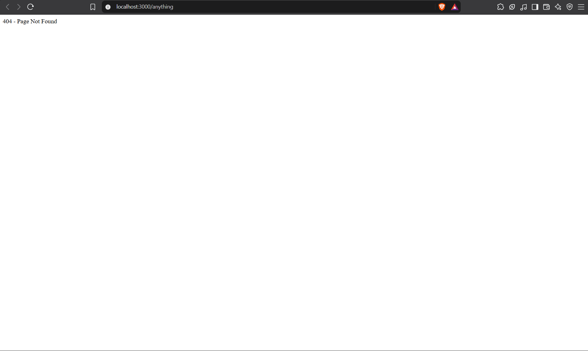

# Lab 1: Node.js and Express Server

## Student Details

- **Name:** S. Ujwal Navadeep
- **Registration Number:** 252U1R7086
- **Section:** CSE FSD - 2B
- **Course:** Backend Development Fundamentals
- **Lab Number:** 01

## Live Link

Deployment is pending. The application runs locally on port 3000. A platform such as Render or Railway can be used to deploy a persistent Node.js server. Static-hosting platforms like GitHub Pages or Vercel's static tier cannot run a persistent Express server.

## Objective

To set up a Node.js project, create a basic HTTP server using the built-in `http` module, and build an Express server with multiple routes and appropriate HTTP status codes.

## Technologies Used

- Node.js
- Express.js
- JavaScript
- npm
- Visual Studio Code

## Project Structure

```text
lab-01/
├── screenshots/
│   ├── home.png
│   ├── about.png
│   ├── time.png
│   └── not-found.png
├── server-http.js
├── server.js
├── package.json
├── package-lock.json
├── .gitignore
└── README.md
```

## package.json Fields Explained

| Field | Description |
|---|---|
| `name` | The name of the project (`lab-01`) |
| `version` | Current version of the project (`1.0.0`) |
| `description` | A short description of the project |
| `main` | The entry point of the application (`server.js`) |
| `scripts` | Defines shorthand commands; `start` runs `node server.js` |
| `author` | The developer's name |
| `license` | The open-source license type (`ISC`) |
| `dependencies` | Lists runtime packages the project needs (e.g. `express`) |

## Installation and Setup

### Prerequisites

- Node.js and npm installed
- Visual Studio Code or another code editor

### Steps to Run

1. Clone the repository or download the project.
2. Open the project folder in the terminal.
3. Install the dependencies:

   ```bash
   npm install
   ```

4. Start the Express server:

   ```bash
   node server.js
   ```

5. Open the following URL in your browser:

   `http://localhost:3000`

### How to Run the Basic HTTP Server

To run the server implemented using Node.js's built-in HTTP module:

```bash
node server-http.js
```

> **Note:** Stop the running server with `Ctrl + C` before starting another server on the same port (3000).

## Endpoints

| Method | Endpoint | Description | Expected Status |
|---|---|---|---|
| GET | `/` | Returns a welcome message | 200 OK |
| GET | `/about` | Returns student name and section in JSON | 200 OK |
| GET | `/time` | Returns the current date and time | 200 OK |
| GET | `/anything` | Any undefined route (example) returns 404 | 404 Not Found |

> `/anything` is just an example. All undefined routes return `404 Not Found`.

## Screenshots

### GET / — Home Route (200 OK)



### GET /about — About Route (200 OK)



### GET /time — Time Route (200 OK)


### GET /anything — Unknown Route (404 Not Found)



## HTTP Status Codes

| Status Code | Meaning | Used For |
|---|---|---|
| `200 OK` | Request was successful | All valid routes (`/`, `/about`, `/time`) |
| `404 Not Found` | The requested resource does not exist | Any undefined route |

## Viva Questions and Answers

### 1. What is the difference between `package.json` and `node_modules`?

`package.json` is a configuration file that lists the project's name, version, scripts, and dependencies (packages the project needs). `node_modules` is a folder that npm creates when you run `npm install` — it contains the actual downloaded code of those dependencies. You track `package.json` in Git, but never `node_modules` (it is excluded via `.gitignore`) because it can always be regenerated from `package.json`.

### 2. What does `app.listen()` do?

`app.listen(PORT, callback)` starts the Express web server and makes it listen for incoming HTTP requests on the specified port number. The optional callback function runs once the server has successfully started. For example, `app.listen(3000, () => console.log('Server running'))` starts the server on port 3000 and prints a confirmation message.

### 3. What do `request` and `response` represent?

In a route handler such as `app.get('/', (request, response) => { ... })`:
- `request` (also written as `req`) represents the incoming HTTP request. It contains information such as the URL path, query parameters, headers, and any body data sent by the client.
- `response` (also written as `res`) represents the outgoing HTTP response. It is used to send data back to the client — for example, `response.status(200).send('Hello')` sets the status code to 200 and sends a plain-text body.

## Problems Faced and Solutions

| Problem | Solution |
|---|---|
| PowerShell maps `curl` to `Invoke-WebRequest` with different syntax | Used `Invoke-WebRequest -Uri` directly in PowerShell for route testing |
| Port 3000 conflict when both servers were running | Stopped `server-http.js` with Ctrl+C before starting `server.js` |

## Git and Repository Notes

- `node_modules/` is excluded via `.gitignore` and must never be committed.
- `.env` is also excluded to prevent accidental secret exposure.
- Run `npm install` after cloning the repository to restore dependencies.
- Do not force-push or overwrite existing Git history.
