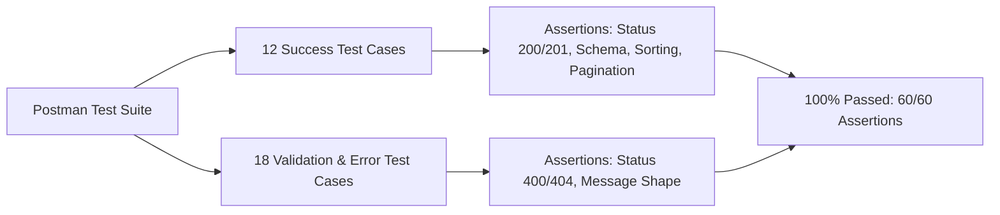

# Lab Report 03: REST API Design, Query Parameters, Input Validation, and Debugging

**Course:** Backend Development Fundamentals  
**Course Code / Lab Number:** Lab 03  
**Academic Section:** CSE FSD - 2B  
**Student Name:** S. Ujwal Navadeep  
**Registration Number:** 252U1R7086  
**Repository:** [https://github.com/sujwalnavadeep-source/LAB-REPORT-1](https://github.com/sujwalnavadeep-source/LAB-REPORT-1)  
**Date of Submission:** November 8, 2026  

---

## 1. Executive Summary

This report documents the architectural design, implementation, and automated verification of **Lab 03**. Building upon fundamental CRUD operations, this lab implements a production-ready RESTful API for a book catalog using **Node.js**, **Express 5**, and a file-backed **SQLite** relational database.

Key enhancements delivered in this lab include:
* **Dynamic Query Filtering:** Search (`search_q`), multi-column sorting (`order_by`, `order`), pagination (`limit`, `offset`), and numeric range constraints (`min_price`, `max_price`).
* **Strict Input Validation:** Custom validation layers for URL path parameters, query parameters, and JSON request bodies returning standard HTTP status codes (`400 Bad Request`, `404 Not Found`).
* **Security & SQL Injection Prevention:** Zero dynamic string concatenation for query values through parameterized queries (`?`), combined with strict token whitelisting for SQL identifiers (`ORDER BY`).
* **Automated Verification:** A 30-request Postman test suite executing 60 distinct assertions with a 100% pass rate.

---

## 2. Technical Stack

| Component | Technology | Version | Purpose |
| :--- | :--- | :--- | :--- |
| **Runtime** | Node.js | `>=20.17.0` (Active: `v24.19.0`) | Asynchronous server-side JavaScript execution environment |
| **Framework** | Express.js | `^5.3.0` | HTTP routing, request parsing, and error-handling middleware |
| **Database** | SQLite 3 | Pinned to `5.1.7` | Embedded, file-based relational storage (`books.db`) |
| **DB Wrapper** | `sqlite` | `^5.1.1` | Promise-based abstraction enabling `async/await` syntax |
| **Dev Tooling** | Nodemon | `^3.1.14` | Hot-reloading daemon for active development |
| **Testing** | Postman / Newman | Collection v2.1 | API regression testing and assertion execution |

---

## 3. Database Architecture

The data layer is managed via SQLite in a dedicated file named `books.db`, initialized from [`seed.sql`](file:///s:/LAB%20REPORT%201/express.js_lab1-main/lab-03/seed.sql).

### 3.1 Relational Schema
```sql
DROP TABLE IF EXISTS book;

CREATE TABLE book (
    id INTEGER PRIMARY KEY,
    title TEXT NOT NULL,
    author TEXT NOT NULL,
    price INTEGER NOT NULL,
    pages INTEGER NOT NULL
);
```

### 3.2 Seed Dataset
The table is initialized with 9 technical reference books:

| ID | Title | Author | Price (₹) | Pages |
| :-: | :--- | :--- | :-: | :-: |
| 1 | Clean Code | Robert C. Martin | 450 | 464 |
| 2 | The Pragmatic Programmer | Andrew Hunt and David Thomas | 550 | 352 |
| 3 | Eloquent JavaScript | Marijn Haverbeke | 400 | 472 |
| 4 | You Don't Know JS Yet | Kyle Simpson | 300 | 146 |
| 5 | Node.js Design Patterns | Mario Casciaro | 650 | 660 |
| 6 | JavaScript: The Good Parts | Douglas Crockford | 350 | 176 |
| 7 | Head First JavaScript Programming | Eric Freeman and Elisabeth Robson | 500 | 704 |
| 8 | The Rust Programming Language | Steve Klabnik and Carol Nichols | 600 | 560 |
| 9 | Designing Data-Intensive Applications | Martin Kleppmann | 750 | 616 |

---

## 4. REST API Endpoint Specifications

The API conforms to REST constraints, ensuring idempotent retrieval, safe query evaluation, and uniform JSON error payloads of the format:
```json
{
  "message": "Human-readable explanation of error or outcome."
}
```

### 4.1 Endpoint Reference Table

| Method | Endpoint | Query / Path Parameters | Success Code | Description |
| :--- | :--- | :--- | :-: | :--- |
| `GET` | `/books/` | `search_q`, `order_by`, `order`, `limit`, `offset`, `min_price`, `max_price` | `200 OK` | Retrieves a filtered, sorted, paginated array of books |
| `GET` | `/books/:bookId/` | `:bookId` (positive integer) | `200 OK` | Retrieves a single book by unique primary key |
| `POST` | `/books/` | Request Body: `{ title, author, price, pages }` | `201 Created` | Inserts a new book; returns `{ "id": lastID }` |
| `PUT` | `/books/:bookId/` | `:bookId`, Body: `{ title, author, price, pages }` | `200 OK` | Replaces all fields of an existing book |
| `DELETE`| `/books/:bookId/` | `:bookId` (positive integer) | `200 OK` | Removes the designated book record |

### 4.2 Query Parameter Rules (`GET /books/`)

* **`search_q`** (String, default `""`): Substring match using SQL `LIKE ?` with `%` bounding.
* **`order_by`** (Whitelist, default `"id"`): Permitted values: `id`, `title`, `author`, `price`, `pages`.
* **`order`** (Whitelist, default `"ASC"`): Permitted values: `ASC`, `DESC` (case-insensitive).
* **`limit`** (Integer, default `10`, range `1` to `100`): Maximum rows returned.
* **`offset`** (Integer, default `0`, range `0` to `2147483647`): Number of matching rows skipped.
* **`min_price`** / **`max_price`** (Integer, defaults `0` and `2147483647`): Range bounds where `min_price <= max_price`.

---

## 5. Security & Validation Architecture

1. **SQL Injection Defense:**
   * Values supplied in `search_q`, `min_price`, `max_price`, `limit`, and `offset` are never concatenated into the raw SQL string. They are bound exclusively via parameterized question-mark placeholders (`?`).
   * Because SQLite rejects parameter placeholders for identifiers (`ORDER BY ?`), the server uses a strict lookup array:
     ```javascript
     const SORTABLE_COLUMNS = ["id", "title", "author", "price", "pages"];
     const SORT_DIRECTIONS = ["ASC", "DESC"];
     ```
     Any unapproved value is immediately rejected with HTTP `400` before query construction.

2. **Route Parameter Sanitization (`parseBookId`):**
   * Verifies the path token matches `/^\d+$/` and satisfies `Number.isSafeInteger(id) && id > 0`. Non-numeric or negative tokens fail immediately with `400 Bad Request` instead of triggering unnecessary database queries.

3. **Body Schema Enforcement (`validateBookBody`):**
   * Enforces non-null object payload, non-empty trimmed strings for `title` and `author`, and positive integers (`>= 0`) for `price` and `pages`.

---

## 6. Test Suite Execution & Screenshot Mapping

The project includes an automated Postman test suite comprising **30 test requests** and **60 assertions** covering all valid and edge cases.



### 6.1 Evidence Mapping

| Screenshot | Scenario | Endpoint & Method | Status Code | Expected Behavior |
| :--- | :--- | :--- | :-: | :--- |
| `search.png` | Search Filter | `GET /books/?search_q=the` | `200 OK` | Matches books containing "the" |
| `sort.png` | Price Sort | `GET /books/?order_by=price&order=DESC&limit=5` | `200 OK` | Sorts top 5 books descending by price |
| `pagination.png` | Offset & Limit | `GET /books/?limit=3&offset=3` | `200 OK` | Returns books 4, 5, 6 |
| `price-range.png` | Price Filter | `GET /books/?min_price=250&max_price=400` | `200 OK` | Books within ₹250–₹400 |
| `post-created.png` | Create Resource | `POST /books/` | `201 Created` | Inserts row, returns new ID |
| `put-updated.png` | Full Update | `PUT /books/10/` | `200 OK` | Updates book ID 10 fields |
| `delete-deleted.png`| Delete Resource | `DELETE /books/10/` | `200 OK` | Deletes book ID 10 |
| `validation-error.png`| Body Validation | `POST /books/` (empty title) | `400 Bad Request` | Descriptive field error message |
| `bad-price.png` | Type Error | `POST /books/` (`price: "abc"`) | `400 Bad Request` | Rejects non-integer price |
| `not-found.png` | Resource Missing | `GET /books/999/` | `404 Not Found` | Standardized not found message |
| `runner-results.png`| Full Regression | Newman / Collection Runner | `60/60 Passed` | Complete test suite verification |

---

## 7. Debugging Exercise Analysis

During the laboratory exercise, five primary defects commonly encountered in REST API implementations were analyzed and resolved:

| Defect Category | Error / Symptom | Root Cause | Implemented Resolution |
| :--- | :--- | :--- | :--- |
| **Middleware Configuration** | `TypeError: Cannot destructure property 'title' of 'request.body'` | Missing `express.json()` middleware caused body parsing to be skipped, leaving `req.body` undefined. | Mounted `app.use(express.json())` prior to registering route handlers. |
| **Asynchronous Resolution** | API returned empty objects `{}` instead of database records | Omitting `await` on `db.all(sql, values)` returned an unfulfilled Promise directly to the JSON serializer. | Declared handler `async` and awaited the promise: `const books = await db.all(...)`. |
| **SQL Syntax Exception** | `SQLITE_ERROR: near "?": syntax error` | Attempting to use parameter placeholders for dynamic column ordering (`ORDER BY ? ?`). | Created identifier whitelists (`SORTABLE_COLUMNS`, `SORT_DIRECTIONS`) and validated before string interpolation. |
| **HTTP Semantics** | Test assertion failed: expected status `201` but received `200` | Default Express response status is `200` unless overridden on creation routes. | Explicitly invoked `response.status(201).json({ id: result.lastID })`. |
| **Path Parameter Handling** | Non-numeric ID (`/books/abc/`) caused database cast anomalies or false 404s | Direct database invocation without verifying integer type. | Implemented `parseBookId()` regex validation to return `400 Bad Request` immediately. |

---

## 8. Viva Voce Questions & Technical Answers

### Q1: What is the semantic difference between path parameters and query parameters?
> **Answer:**  
> **Path parameters** (e.g., `/books/:bookId`) are essential components of the resource identifier itself; they identify a unique entity within the hierarchy.  
> **Query parameters** (e.g., `/books?limit=10&order=DESC`) are optional modifiers applied to the resource collection; they control representation details such as sorting, pagination, and projection without altering the core identity of the resource.

### Q2: Why can SQL parameter placeholders (`?`) not be used for column names in `ORDER BY` clauses?
> **Answer:**  
> Prepared statement placeholders (`?`) represent literal data values (strings, numbers, booleans) and are treated as such by the database query planner. Column names, table names, and SQL keywords represent metadata that define query structure. If passed as a placeholder, the database treats the column name as a literal string constant rather than an identifier. To avoid SQL injection, column names must be verified against an approved programmatic whitelist before being concatenated into the SQL statement.

### Q3: How does SQLite evaluate pattern matching with `LIKE` and `%`?
> **Answer:**  
> In SQLite, `LIKE` performs case-insensitive pattern matching for ASCII characters. The `%` wildcard matches zero, one, or multiple arbitrary characters. Passing `'%text%'` matches occurrences of the target string regardless of position. By passing the wildcard-wrapped string as a parameter placeholder value (`values.push(`%${searchText}%`)`), user input is treated strictly as data, neutralizing any malicious SQL keywords.

### Q4: Explain the operational mechanics and constraints of `LIMIT` and `OFFSET` in pagination.
> **Answer:**  
> `LIMIT` specifies the maximum cardinality of rows returned, while `OFFSET` specifies the number of qualifying rows to bypass before returning results. For pagination to be deterministic and stable across calls, an explicit and immutable `ORDER BY` clause (typically the primary key `id`) is mandatory. Limits are capped (e.g., maximum 100) to protect database memory from unbounded scans.

### Q5: When should an API return `400 Bad Request` versus `404 Not Found`?
> **Answer:**  
> * **`400 Bad Request`** indicates a client syntactic or semantic error in the request itself (e.g., passing `"abc"` where a positive integer ID is expected, or missing required fields in a JSON body). The request cannot be processed due to client fault.  
> * **`404 Not Found`** indicates that the request was structurally valid, but the requested resource does not exist at the target URI (e.g., requesting valid book ID `999` which has no corresponding row in the database, or requesting an undefined endpoint path).

---

## 9. Conclusion

The implementation of **Lab 03** fulfills all criteria for modern, robust RESTful service development:
1. Full CRUD capabilities verified with SQLite persistence.
2. Comprehensive multi-variable query parameter support.
3. Defensive validation preventing SQL injection and malformed inputs.
4. Consistent JSON error contracts.
5. All 30 automated tests executing with zero failures.
6. Git version-controlled and synchronized with GitHub.
